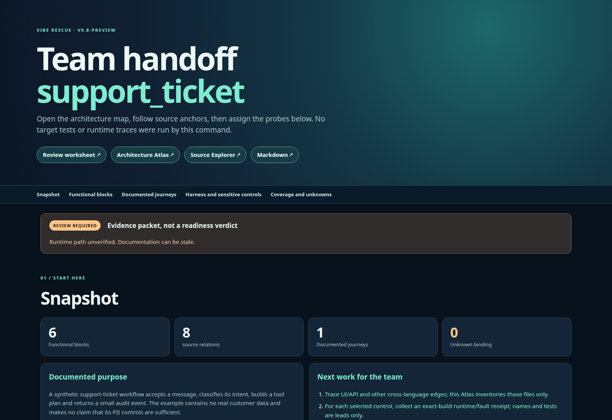
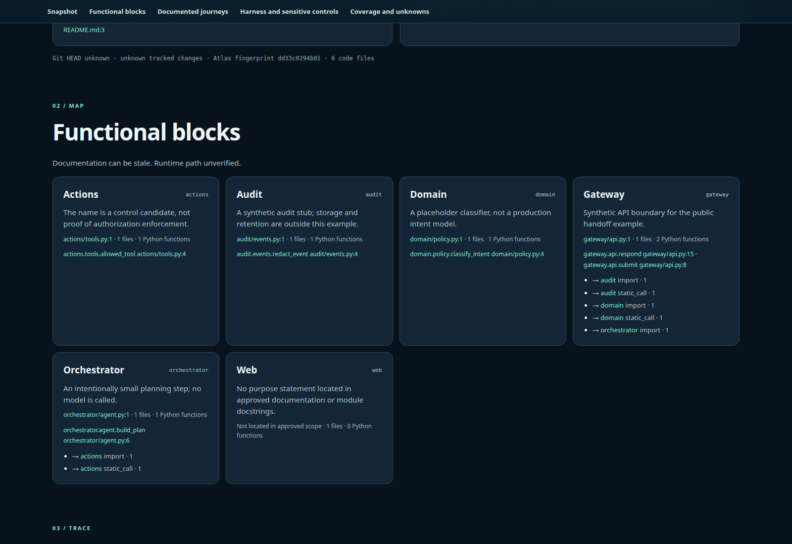

# Vibe Rescue: turn an unfamiliar codebase into a team handoff

English · [Tiếng Việt](README.vi.md) · [Full guide](docs/GUIDE.md)

By [Nguyễn Anh Nguyên](https://github.com/thusinh1969) (Nguyen Anh Nguyen) · free and open source (MIT)

<!-- markdownlint-disable MD013 -->

**Vibe Rescue** gives a new team a source-linked handoff for a codebase nobody understands: what it does, how its parts connect, which request steps map to real functions, and what must be verified before a sensitive system can ship. Its first pass runs offline with no AI. Scanner findings and owner-gated repair are available when the team is ready.

## Run it in 1 minute

You need Git, Python 3.11 or newer and Bash. There is nothing to install with pip: the first `./vr` prepares its own private environment in `.venv` (about 10 seconds).

```bash
git clone https://github.com/thusinh1969/vibe_rescue.git
cd vibe_rescue
./vr doctor                               # checks your machine, says what is missing and how to fix it
./vr explore ~/path/to/your-project       # map and team handoff, no AI, a few seconds
./vr check   ~/path/to/your-project       # concrete problems with file and line, no AI
```

Then open `~/path/to/your-project/VIBE_RESCUE/START_HERE.md`: one page with what was found and which file to open next. Your project's own files are not changed, and `VIBE_RESCUE/` ignores itself in Git. The project must be a Git repository; if it is not, run `git init && git add -A && git commit -m "before rescue"` in it first.

For a plain-language AI report and fixes you approve, continue at [Step 3](#step-3-ai-report-optional) and [Step 4](#step-4-fix-with-your-approval). The longer explanations are in the [full guide](docs/GUIDE.md).

## What you get

All of it is written into `VIBE_RESCUE/` inside your project.

| file | what it is | for |
|---|---|---|
| `START_HERE.md` | one page: what was found, what to open next (English and Vietnamese) | everyone |
| `handoff.html`, `handoff.vi.html` | team handoff: purpose, functional blocks, function leads, unknowns | new teammates |
| `HANDOFF.md` | the same as text; paste it into Claude, Codex or any model | you and your AI |
| `REVIEW_WORKSHEET.md` | who proves what; reruns keep your edits | team lead |
| `architecture.html`, `source-explorer.html` | architecture map and a searchable function index | engineers |
| `atlas/INDEX.md` | maps for every language found (Python, JavaScript/TypeScript, Rust, Go, Java, PHP, C#); `manifest.json` there says how complete they are | engineers |
| `check/findings.md` | the problem list with file, line and rule | engineers |
| `report/README.md`, `PROPOSALS.md` | the AI report in plain words, one card per problem (after Step 3) | the team |

## v0.8-preview — what is new

- **One command, a handoff the whole team can use.** The generic Atlas now writes HTML and Markdown handoffs in English and Vietnamese, plus an editable review worksheet in each language. Reruns preserve the team’s worksheet.
- **From intent to code.** The packet joins documented purpose → functional blocks → Python callsites → numbered journeys → exact function anchors. Config/prompt paths, coverage and unknowns stay visible.
- **Review work is already framed.** Agent, swarm, PII/PHI, medical and billing profiles list source leads and concrete next probes. A lead is never labelled safe or production-ready; the reviewer must run target-specific tests and traces.



[Open the complete example handoff](https://thusinh1969.github.io/vibe_rescue/examples/support_ticket/VIBE_RESCUE/handoff.html) · [Read its Markdown packet](examples/support_ticket/VIBE_RESCUE/HANDOFF.md) · [Run it on your own repo](#run-it-in-1-minute).



## Step by step

### Step 1: Explore (no AI)

```bash
./vr explore ~/path/to/your-project
```

Two things run. The **atlas** maps every language it finds from the Git-tracked files. The **handoff** (Python only) joins the project's own documentation to functional blocks and function names. Neither runs your code. If the map ends with "partial" (exit code 2), the map exists but some parts are missing; `atlas/manifest.json` lists which.

### Step 2: Check (no AI)

```bash
./vr check ~/path/to/your-project
```

For a Python project this runs `ruff`, `vulture`, `radon` and `bandit` (dead code, complexity, common security mistakes). Choose others with `--tools`, for example `--tools ruff,deptry,jscpd`; some need Node. The first run saves today's problems as a **baseline**, so later runs show only what is new. A tool that was skipped or failed did **not** check anything; `START_HERE.md` lists those under "NOT checked".

### Step 3: AI report (optional)

The AI explains the findings in plain words. Maps and checks need none. Pick one:

```bash
./vr ai claude                                    # A: Claude Code, with Codex as the second checker (both installed and logged in)
./vr ai openai --url https://your-server/v1 --model YOUR-WRITER-MODEL --checker-model YOUR-OTHER-MODEL    # B: any OpenAI-style server
read -rsp 'Key: ' VIBE_AGENT_API_KEY; export VIBE_AGENT_API_KEY     # B only; a local server may need no key
./vr report ~/path/to/your-project
```

Option B works with open models you host yourself and with any hosted model; use two different models for writer and checker. Only one hosted model has been tried so far, on a toy project. The AI receives your code and the findings, so use it only where you may share that code with it. Open `VIBE_RESCUE/report/README.md`, then `PROPOSALS.md`. If `./vr report` says the AI did not write the report, you got a fill-in template; run `./vr doctor`.

### Step 4: Fix with your approval

```bash
./vr fix ~/path/to/your-project --test "python -m pytest -q"
```

`--test` is a command that proves the project works today. It must pass **before** any change and must not leave new files behind (for example `__pycache__/`); add those to the project's `.gitignore`. Then: the AI writes one small plan, you approve it; a backup tag is made; the fix is made on a separate branch; your test and the checkers run again; a second AI reviews; you decide whether to merge, and `REVERT.md` gives the undo command. If nobody answers, the run stops. Nothing merges on its own.

## If something goes wrong

| you see | do this |
|---|---|
| "not a Git repository" | in the project: `git init && git add -A && git commit -m "before rescue"` |
| "Python 3.11 or newer is required" | install Python 3.11+, then run `./vr` again |
| `./vr doctor` shows MISSING | follow the line under it |
| the map is "partial" (exit code 2) | open `VIBE_RESCUE/atlas/manifest.json`; it lists what is missing, for example Node for JavaScript |
| a checker "FAILED" or "skipped" | it did not run; read `VIBE_RESCUE/logs/check.log` for the reason |
| "no AI is configured yet" | Step 3 |
| you want everything gone | in the project: `rm -rf VIBE_RESCUE .rescue .ruff_cache`; nothing else was created |

## Limits

- The map is static: it shows who can call whom, not run-time behavior. The generic handoff connects Python functions only; other languages get file-level maps.
- A finding is evidence to look at, not proof of a bug.
- A Git branch is not a security sandbox. Checkers, tests and AI programs run with your computer's permissions; use an isolated machine for code you do not trust.
- Unattended repair of production code is not approved. Repair always needs a person.

## In short (FAQ)

**What is Vibe Rescue?**
A free, MIT-licensed toolkit that turns an unfamiliar or AI-generated ("vibe-coded") Git repository into a source-linked team handoff: maps of files, functions and calls, a list of concrete problems with file and line, and, only if the owner approves, small reversible fixes.

**Is it free, and does it need an AI?**
It is free. Mapping and the handoff run offline with no AI. The AI steps (report, plan, repair) are optional and can use Claude Code, Codex, or any OpenAI-style model server, including open models you host. Only one hosted model has been tried so far, on a toy project.

**Does my code leave my machine?**
Not for mapping and checks, which run locally (third-party checking tools may be downloaded). The optional AI steps send code and findings to whichever AI you choose.

**Which languages does it support?**
Python, JavaScript/TypeScript, Rust, Go, Java, PHP and C#, with different levels of detail. The generic handoff connects Python functions only.

**Can it fix my code automatically?**
It prepares small fixes on a separate branch. Every plan, repair and merge needs a human yes, and a file tells you how to undo it. Unattended repair of production code is not approved.

**How is it different from paid vibe-code rescue services?**
Those are done-for-you human services. Vibe Rescue is a free tool you run yourself, with evidence you can check. It does not replace an engineer's judgment.

## Contributors

In this order:

1. **Nguyễn Anh Nguyên**: author and maintainer.
2. **DeepSeek**: AI collaborator; model evaluation runs and visual review of the documentation (see [STATUS.md](STATUS.md)).
3. **Codex** (OpenAI): AI collaborator; earlier versions and independent review.
4. **Claude** (Anthropic): AI collaborator; README rewrite, the OpenAI-style adapter and release preparation.

## Status and license

**v0.8-preview** creates a source-linked team handoff from any approved repo scope, with a review worksheet to collect owners and exact-build receipts. The [preview contract](docs/V0.8_PREVIEW.md) explains what the generic Atlas proves and what remains a reviewer task. A detailed control review is written by a human reviewer; the tool does not generate an equivalent safety verdict for every team. Repair still requires owner approval and has [open safety gaps](STATUS.md#current-preview-gaps). Package tooling may normalize `0.8.0-preview` to `0.8.0rc0`.

License: [MIT](LICENSE).

<!-- markdownlint-enable MD013 -->
