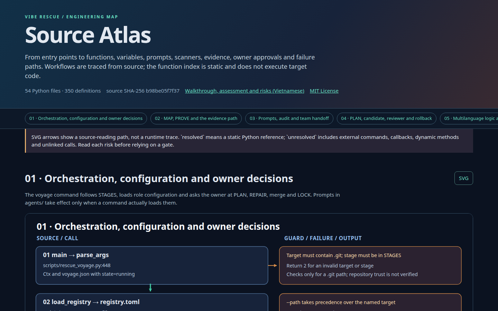

# Vibe Rescue: map, audit and safely clean up messy or AI-generated code

English · [Tiếng Việt](README.vi.md)

<!-- markdownlint-disable MD013 -->

**Vibe Rescue** is a MIT-licensed toolkit that turns a codebase nobody understands into a **searchable map** and a **list of concrete problems** (dead code, copy-paste, tangled dependencies, leaked secrets, outdated libraries), then prepares **small, reversible fixes, only with your approval**.

Good for: inheriting a legacy project, cleaning up "vibe-coded" or AI-generated code, auditing technical debt, and onboarding a new developer. It works on any Git project and maps Python, JavaScript/TypeScript, Rust, Go, Java, PHP and C#. Mapping and checking use free tools and need **no paid AI**.

It does two jobs:

1. **EXPLORE.** It reads the project and shows your team what is really in it: which parts exist, what starts the program, which files are huge, who depends on whom, and which parts nobody understands.
2. **FIX.** It finds what is wrong (dead code, copy-paste, over-complicated files, tangled dependencies, leaked passwords, outdated libraries), explains each problem in plain words with the exact file and line, and, only if you approve, prepares small fixes that can be undone.

> **Your project is never changed without a human "yes".** Exploring and checking only read. Every fix needs your approval and can be reverted.

## The problem it solves

A team that builds fast ("vibe coding", with people or AI) ends up with a project like this:

- Nobody can say how the parts fit together.
- Files with thousands of lines that do ten different jobs.
- The same code copied in five places.
- Code and libraries that nobody uses any more but nobody dares to delete.
- Two rule files that say opposite things.
- Fear: "if I fix this, three other things will break".

Vibe Rescue turns that fog into **a list of concrete, checkable facts** and **a safe path to fix them**.

## Job 1: EXPLORE (what you learn)

| Question your team asks | What Vibe Rescue gives you |
| --- | --- |
| "What is in this project?" | Languages used, what starts the program (entry points), how tests run, the 10 largest files, which files look generated or copied from elsewhere. |
| "Who calls whom?" | Searchable web pages and pictures of every file, function, import and function call. Python, JavaScript/TypeScript, Rust, Go, Java, PHP and C# are supported, with [different levels of detail](docs/LOGIC_ATLAS.md). |
| "Which parts are tangled?" | Files that import each other in circles, files everyone depends on, and the largest files. |
| "What do we not understand?" | A list of **unknowns**. The tool writes "I don't know" instead of guessing. |
| "Where was the code rushed?" | Which files were rewritten the most in the Git history. |
| "What AI rules and tools are lying around?" | An inventory of rule files (`CLAUDE.md`, `AGENTS.md`, `.cursorrules`, ...) and which ones are unused, outdated, duplicated or contradict each other. |



[Open this project's own Source Atlas](docs/assets/repo-explorer.en.html) to see what such a map looks like. The picture above is a screenshot of that page.

## Job 2: FIX (what it looks for)

Free, well-known checking tools search the code. Every result is saved with its file and line. Nothing is "a feeling".

| Problem in plain words | How it is found |
| --- | --- |
| **Dead code**: functions and files nobody calls | `vulture` (Python), `knip` (JavaScript/TypeScript) |
| **Over-complicated functions**: too many branches to understand | `radon`, `ruff` |
| **Copy-paste**: the same block in several places | `jscpd` |
| **Tangled structure**: files importing each other in circles, one file everyone needs | built-in import-graph check, `dependency-cruiser`, `import-linter` |
| **Unused or missing libraries** | `deptry` |
| **Security mistakes**: passwords in code, `eval`, running shell commands unsafely, unsafe file extraction | `bandit`, `semgrep` with rules in `tools/rules/` |
| **Leaked secrets** and **libraries with known holes** | `gitleaks`, `trivy`, `osv-scanner` (downloaded by the optional installer) |
| **Broken links and messy docs** | `lychee`, `markdownlint` |
| **Personal data** such as Vietnamese phone and ID numbers in code | custom rules in `tools/rules/` |

The first run saves **a snapshot of today's problems** (called a "baseline"). Every later run tells you only what is **new**, so the team can pay off old problems step by step instead of facing a wall of red.

Tools that are not installed are reported as `skipped` or `failed`. That means **not checked**; it never means "no problems".

## Who does what: machines, AI, you

| Who | What they do | Why |
| --- | --- | --- |
| **Machines** (the checking tools above) | Find problems and record file, line and evidence. | They are exact and repeatable. They do not guess. |
| **AI, writer** | Reads the machine results, explains each problem in plain words, writes a small plan, and makes the fix on a separate branch. | The machines find problems but cannot explain them or write code. The AI can. It is only allowed to use findings the machines recorded. |
| **AI, checker** | Re-runs everything and reads the change as a second pair of eyes. | An AI that checks its own work misses its own mistakes. A second model, different from the first, is a real second opinion. |
| **You** | Approve the plan, approve the repair, decide the merge. | You know your business. Silence is never a "yes": if nobody answers in time, the run stops. |

## Which AI do I need? You choose, any budget

**You do not need an expensive AI.** The AI's jobs here are small and clearly bounded: read the machine results, explain them, write one small plan, check a change. Two ordinary models are enough. A stronger one is optional.

| Your situation | Suggested models (maintainer's guidance, not measured by this repository) |
| --- | --- |
| Free or very cheap: run on your own machine or a cheap server | **Gemma-4-31B** and **Qwen 3.8 27B**: one writes, the other checks |
| Want stronger, still cheap | DeepSeek V4.1 Flash, Haiku, GPT Luna 6 |
| Large or very tangled project | Claude Sonnet 5.5, GPT 6.1 Sol, Kimi K3, Qwen 3.8 Max, GLM 5.3 |

The design goal is **any server that speaks the common OpenAI-style `/v1/chat/completions` format**, so you can swap models without changing anything else. Use two *different* models for writer and checker; the point is that the checker is not the writer. "Open-weight" simply means models whose files you can download and run yourself, which is the cheapest option and keeps your code on your own machine.

**What works today, honestly:**

- Steps 1 and 2 (explore and find problems) need **no AI at all**.
- The AI steps (report, plan, repair, second check) can run through either:
  - **Claude Code and Codex**, command-line agent programs (paid; the default in `config.toml`), or
  - the built-in adapter `scripts/openai_agent.py` for **any OpenAI-style server**: set `cli = "openai"`, the model id and `--base-url` (see step 3, option B). The adapter gives the model read-only tools and lets it write only where each step allows. It cannot run commands; Vibe Rescue itself runs the tests, scanners and scope checks.
- **Tested so far:** automatic tests with a scripted fake server (what may be read and written, secrets hidden, failures), and **one full run on a tiny made-up project with one hosted model** (`deepseek-flash`): report, plan, your approvals, a one-line fix, the second check, merge and the undo file all worked. **Not tested yet:** Gemma or Qwen on a real server, and any real project. One run is an observation, not a statistic.
- Weaker models can write a plan that fails the plan check or a fix that the second check rejects. Then the tool **stops and changes nothing**; that is the safety net working, not a crash.
- A separate sample-task test (`scripts/model_rescue_eval.py`, last section) grades a model on made-up tasks. Only `deepseek-flash` has recorded results (map 4 of 4, plan 4 of 4, review 3 of 4, or 4 of 4 after fixing a slip in the grader); for Gemma and Qwen the test exists but no results are recorded.

## Quick start

You need **Git**, **Python 3.11 or newer** (with `venv` and `pip`) and **Bash**. The optional downloaded checking tools are pinned for Linux x86-64 only.

> The GitHub repository is currently **private**, so you need access to clone it.

### Step 1: your first map (5 minutes, no AI, no account)

Copy this single line into a terminal. It downloads the tool, sets it up in its own folder, and makes a first inventory of Vibe Rescue itself:

```bash
git clone https://github.com/thusinh1969/vibe_rescue.git && cd vibe_rescue && python3 -m venv .venv && . .venv/bin/activate && python -m pip install uv tree-sitter-language-pack==0.13.0 && python scripts/logic_atlas.py --target . --inventory-only --outdir reports/first-look
```

Open `reports/first-look/INDEX.md`. If you open a new terminal later, switch the tool back on first: `cd vibe_rescue && . .venv/bin/activate`.

Now map **your** project:

```bash
python scripts/logic_atlas.py --target /path/to/your/project --outdir reports/atlas
```

Open `reports/atlas/INDEX.md` and follow the links.

- Python projects produce `python-map.html`, `python-map.svg` and `python-calls.dot`.
- JavaScript/TypeScript projects produce `frontend-map.html` and `frontend-functions.html` (needs Node and `npx`).
- Add `--pdf` for a PDF if a PDF renderer is installed.
- Only files tracked by Git are read.
- Exit code `2` with the word `INCOMPLETE` means the map exists but some parts are missing. Open `manifest.json` in the same folder to see which.
- For a large project, map one folder at a time: add `--scope path/to/folder`.

### Step 2: find the problems (no AI)

For a Python project:

```bash
python scripts/rescue_voyage.py --path /path/to/your/project --stages map,prove --tools ruff
```

`--tools ruff` runs one checker. Leave `--tools` out to run every checker that is available.

Read:

- `<your project>/.rescue/voyage/prove/findings.md`: the problem list.
- `<your project>/.rescue/voyage/run.summary.json`: what ran and what did not.

Everything is written into the hidden folder `.rescue/` of your project. Add `.rescue/` to that project's `.gitignore` so it is not committed by accident. For code you do not trust, work inside a throwaway virtual machine or container, because checking tools may run the project's own settings (see [SECURITY.md](SECURITY.md)).

### Step 3: get the report in plain words (needs an AI)

Choose one option. If you use no AI, steps 1 and 2 already give you a lot. See also [Which AI do I need?](#which-ai-do-i-need-you-choose-any-budget).

**Option A: Claude Code and Codex** (paid, command-line programs). Install and log in once:

```bash
npm install -g @anthropic-ai/claude-code @openai/codex
claude auth login
codex login
cp config.toml config.local.toml
```

Open `config.local.toml`. It says which program plays which role (leave `model` empty to use each program's default):

```toml
[roles.write]  # writes the plan and the fix
cli = "claude"
model = ""
extra_args = []

[roles.audit]  # writes the report
cli = "claude"
model = ""
extra_args = []

[roles.verify]  # second, independent reviewer of the fix
cli = "codex"
model = ""
extra_args = []
```

**Option B: any OpenAI-style server** (open models you host, or any cheap or strong hosted model). Put this in `config.local.toml`, with the exact model id your server reports at `/v1/models`. Use a *different* model for `verify` than for `write` and `audit`:

```toml
[roles.write]
cli = "openai"
model = "your-writer-model-id"
extra_args = ["--base-url", "https://your-server.example/v1"]

[roles.audit]
cli = "openai"
model = "your-writer-model-id"
extra_args = ["--base-url", "https://your-server.example/v1"]

[roles.verify]
cli = "openai"
model = "your-checker-model-id"
extra_args = ["--base-url", "https://your-server.example/v1", "--api-key-env", "VIBE_CHECKER_API_KEY"]
```

Type the key into your terminal only (never into a file): `read -rsp 'Key: ' VIBE_AGENT_API_KEY; export VIBE_AGENT_API_KEY`. A local server that needs no key can leave it empty. Plain `http://` is accepted on your own machine (`localhost`); for any other host use `https://`, or add `--allow-http` only for a private server you trust.

> **Privacy:** the report, plan and fix steps send your code and findings to the server you chose (the company behind Claude Code or Codex, or your own server in option B). Use them only if you are allowed to share that code with it.

Run:

```bash
VIBE_LLM_CONFIG="$PWD/config.local.toml" python scripts/rescue_voyage.py \
  --path /path/to/your/project --stages map,prove,review --tools ruff
```

You get a small folder, `<your project>/.rescue/voyage/review/`:

| File | For | Contains |
| --- | --- | --- |
| `README.md` | the whole team, 2 minutes | What is good, what to fix first (top 5 to 7), where each number came from. |
| `PROPOSALS.md` | engineers | One card per problem: the problem in plain words, the evidence (file and line), how to fix it step by step, the risk, how to verify, priority. |
| `EVIDENCE/` | whoever wants to check | The raw machine results, a table that marks every number the AI quoted as matching, mismatching or not checkable, and a second AI's cross-check. |

Look for `agent_wrote=True` in the console. If it says `False`, the AI did not run and you received a fill-in template built from the machine results.

An example card (made-up values, only to show the shape):

```text
P-03  Payment code is copied into three files
Evidence:  billing/a.py:40-95, billing/b.py:12-67, billing/c.py:30-85 (copy-paste check)
Fix:       1. Move the shared block into billing/common.py  2. Call it from the three files
Risk:      Medium. All three files handle money.
Verify:    python3 -m pytest tests/billing -q
Not doing: changing any prices or rules
```

### Step 4: fix, with your approval

First choose a **safety command**: a command that proves your project still works today, such as its tests. It must pass **before** any change, and it must **not leave new files behind** (for example Python's `__pycache__/`): add them to `.gitignore`, or the fix is rejected as touching files outside the plan.

```bash
VIBE_LLM_CONFIG="$PWD/config.local.toml" python scripts/rescue_voyage.py \
  --path /path/to/your/project --stages map,prove,review,plan --tools ruff \
  --probe "python3 -m pytest -q" --owner interactive
```

The AI writes **one small plan with one goal**. The tool checks the plan is complete (what files may change, what must not change, a check after each step, when to stop, how to undo). It then prints the plan and asks you in the terminal. Read `<your project>/.rescue/voyage/PLAN-001.md` before you answer. Your approval is tied to the exact text of the plan and the exact version of your project: change either and you must approve again.

If you stop here, nothing in your project has changed. Adding the stage `repair` makes the tool ask for two more "yes" answers (to start, and to merge). The full protocol is in [docs/VOYAGE.md](docs/VOYAGE.md).

## How a fix stays safe

1. A backup tag is put on your project before anything changes.
2. The fix is made on a separate branch in a separate folder, never on your main branch.
3. The AI may only touch the files named in the approved plan. It may not add libraries, change public interfaces, or edit tests just to make them pass.
4. Your safety command runs before and after. If the results differ, the fix is dropped.
5. The checking tools run again. Any **new** problem blocks the fix.
6. The second AI re-runs everything and reads the change. Only "approve" moves on.
7. **You** decide whether to merge. After a merge, `REVERT.md` gives the exact command to undo it.

## Questions and fixes

**What is the difference between EXPLORE and FIX?**
EXPLORE (steps 1 and 2) only reads and draws; run it first on any project. FIX (steps 3 and 4) adds an AI that explains, plans and repairs, always with your approval.

**Do I need an expensive AI?**
No. The checking tools find the problems; the AI only explains, plans and checks. Two ordinary models are meant to be enough, though only one hosted model has been tried so far. See [Which AI do I need?](#which-ai-do-i-need-you-choose-any-budget). Without any AI you still get steps 1 and 2.

**Can I use Gemma or Qwen on my real project?**
The connection exists (option B in step 3), but it has only been tried with a hosted model on a toy project, not yet with Gemma or Qwen. Try it first on a small project or a copy, and run the sample-task test (last section) to see how your model does.

**It says `INCOMPLETE` or exit code 2.**
The map is partial. Read `manifest.json` in the output folder. Typical causes: Node or `npx` is missing (JavaScript/TypeScript), or some imports could not be resolved.

**A tool shows `skipped` or `failed`.**
That part was not checked. Install what the message names, or accept the gap and write it down.

**`agent_wrote=False`.**
The AI program did not run. Check that `claude` or `codex` is installed and that you are logged in, then run the same command again.

**Will it change my project while exploring or checking?**
Vibe Rescue itself only writes into `.rescue/`. Third-party checking tools may create their own cache files, so use a copy of your project if that matters.

**Is the map the truth?**
No. It is read from the code without running it. It shows who *can* call whom, not what happens at run time, and it marks what it could not resolve as `unknown`. To record real paths, use [docs/JOURNEY_TEMPLATE.md](docs/JOURNEY_TEMPLATE.md) and prove them with tests.

## Test any model on sample tasks (works today)

This works with any OpenAI-style server, including open models you run yourself. It sends only made-up code, never your project. Use the exact model name your server reports at `/v1/models`:

```bash
export VIBE_EVAL_BASE_URL="https://your-server.example/v1"
export VIBE_EVAL_MODEL="google/gemma-4-31B-it"
read -rsp 'Server API key: ' VIBE_EVAL_API_KEY; export VIBE_EVAL_API_KEY; printf '\n'
python scripts/model_rescue_eval.py --out reports/model-eval/gemma.json
```

For Qwen, change the model name to the one your server shows and use a different output file. Add `--allow-http` only for a private server you trust. Results and limits: [docs/SMALL_MODEL_EVAL.md](docs/SMALL_MODEL_EVAL.md).

## Limits you should know

- The map is **static**: it is read from the code, not from a running program. It cannot see a button click turning into a web request unless you document that path.
- Checking tools find signals, not verdicts. A finding is evidence to look at, not proof of a bug.
- A Git branch is **not** a security sandbox. Checkers, tests and AI programs run with your computer's permissions. Use an isolated machine for code you do not trust.
- Hiding secrets in reports is best effort. Review `.rescue/`, `reports/` and `logs_audit/` before sharing them.
- Unattended repair of production code is **not approved**. Repair always needs a person.

## Words used here

| Word | Meaning |
| --- | --- |
| **Finding** | A problem reported by a checking tool, with file and line. |
| **Baseline** | The snapshot of today's problems, saved so later runs show only what is new. |
| **Safety command** ("probe") | A command, such as your tests, that must give the same result before and after a fix. |
| **Owner** | The human who says yes or no. |
| **Branch** | A separate copy of the change; your main code is untouched until you merge. |

## What is in this folder

| Folder or file | Purpose |
| --- | --- |
| `scripts/` | The commands you run (`logic_atlas.py`, `rescue_voyage.py`, ...). |
| `agents/` | Written instructions for each AI role (auditors, planner, fixer, reviewer). |
| `tools/` | Which checking tools and versions are used (`tools/manifest.toml`), and the custom rules. |
| `config.toml` | Which AI program plays which role. Copy it to `config.local.toml` to change it. |
| `targets/registry.toml` | An optional address book of projects you rescue often. |
| `docs/` | Detailed documents (mostly in Vietnamese). |
| `tests/` | Automatic tests of Vibe Rescue itself. |

## More reading

Most detailed documents are written in Vietnamese.

- [docs/OWNER_PACT.md](docs/OWNER_PACT.md): the promises made to the project owner.
- [docs/VOYAGE.md](docs/VOYAGE.md) and [docs/PIPELINE.md](docs/PIPELINE.md): every step in detail.
- [docs/LOGIC_ATLAS.md](docs/LOGIC_ATLAS.md): what the maps can and cannot show.
- [docs/OUTPUT_PROTOCOL.md](docs/OUTPUT_PROTOCOL.md): how the report for the team is written.
- [SECURITY.md](SECURITY.md): what is and is not protected.
- [STATUS.md](STATUS.md): what is finished and what blocks a public release.

## Status and license

Version `0.5.0rc1` (release candidate). Exploring and finding problems are ready to use. Repair needs a person and some [release blockers](STATUS.md#public-release-blockers) are still open. The repository is private and its older history is not ready to be made public; see the [release procedure](docs/PUBLIC_RELEASE.md).

License: [MIT](LICENSE).

<!-- markdownlint-enable MD013 -->
