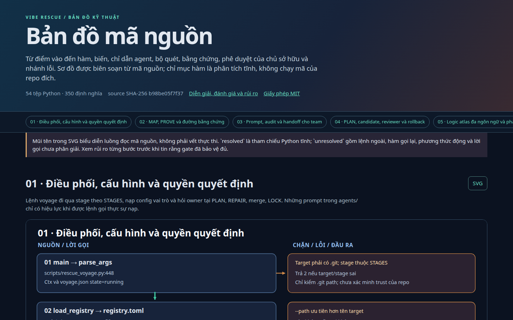

# Vibe Rescue: lập bản đồ và sửa an toàn code lộn xộn hoặc do AI viết

[English](README.md) · Tiếng Việt

<!-- markdownlint-disable MD013 -->

**Vibe Rescue** là bộ công cụ giấy phép MIT biến một dự án không ai hiểu thành **bản đồ tìm kiếm được** và **các phát hiện từ scanner cần kiểm tra** (code chết, code chép lặp, phụ thuộc rối, bí mật bị lộ, thư viện cũ). Sau đó, công cụ có thể chuẩn bị **các bản sửa nhỏ, hoàn tác được, chỉ khi bạn đồng ý**.

Dùng khi: tiếp quản dự án legacy, dọn code "vibe coding" hoặc do AI sinh ra, kiểm toán nợ kỹ thuật (technical debt), và đào tạo thành viên mới. Chạy trên mọi dự án Git và lập bản đồ Python, JavaScript/TypeScript, Rust, Go, Java, PHP và C#. Lập bản đồ và kiểm tra dùng công cụ miễn phí, **không cần AI trả phí**.

Nó làm hai việc:

1. **KHÁM PHÁ (EXPLORE).** Đọc dự án và cho cả team thấy bên trong thật sự có gì: có những phần nào, cái gì khởi động chương trình, file nào quá lớn, ai phụ thuộc vào ai, và phần nào chưa ai hiểu.
2. **SỬA (FIX).** Kiểm tra dấu hiệu vấn đề (code chết, code chép đi chép lại, file quá phức tạp, phụ thuộc rối, mật khẩu bị lộ, thư viện cũ có lỗ hổng), giải thích từng phát hiện kèm file và dòng, và chỉ khi bạn đồng ý mới chuẩn bị các bản sửa nhỏ, hoàn tác được.

> **Sửa source cần bạn duyệt.** KHÁM PHÁ ghi báo cáo và công cụ kiểm tra bên thứ ba có thể tạo cache. Mọi bản sửa đều cần bạn duyệt và hoàn tác được.

## Vấn đề nó giải quyết

Team làm nhanh ("vibe coding", bằng người hoặc AI) thường có dự án như thế này:

- Không ai nói được các phần khớp với nhau thế nào.
- File hàng nghìn dòng làm mười việc khác nhau.
- Cùng một đoạn code bị chép ở năm nơi.
- Code và thư viện không ai dùng nữa nhưng không ai dám xóa.
- Hai file luật nói ngược nhau.
- Nỗi sợ: "sửa chỗ này thì ba chỗ khác hỏng".

Vibe Rescue biến đám sương mù đó thành **danh sách sự thật cụ thể, kiểm chứng được** và **một con đường an toàn để sửa**.

## Việc 1: KHÁM PHÁ (bạn biết được gì)

| Câu team hay hỏi | Vibe Rescue đưa cho bạn |
| --- | --- |
| "Dự án này có gì?" | Ngôn ngữ đang dùng, cái gì khởi động chương trình (điểm vào), test chạy thế nào, 10 file lớn nhất, file nào trông như được sinh tự động hoặc chép từ nơi khác. |
| "Ai gọi ai?" | HTML và SVG tìm kiếm được cho source file đã được Git theo dõi cùng các symbol/lời gọi phân giải được bằng phân tích tĩnh. Sơ đồ Python lớn được chia thành các trang SVG có liên kết; lời gọi qua trang vẫn ở catalog HTML. Lời gọi chưa phân giải được đánh dấu rõ. Python, JavaScript/TypeScript, Rust, Go, Java, PHP và C# có [mức chi tiết khác nhau](docs/LOGIC_ATLAS.md). |
| "Phần nào đang rối?" | File import lẫn nhau theo vòng tròn, file mà ai cũng phụ thuộc, và các file lớn nhất. |
| "Ta chưa hiểu gì?" | Danh sách **điều chưa biết** (unknown). Công cụ ghi "không biết" thay vì đoán. |
| "Chỗ nào bị viết vội?" | File nào bị viết lại nhiều nhất trong lịch sử Git. |
| "Có luật và công cụ AI nào bị bỏ lại?" | Bản kiểm kê các file luật (`CLAUDE.md`, `AGENTS.md`, `.cursorrules`, ...) và cái nào không dùng, cũ, trùng lặp hoặc mâu thuẫn nhau. |



[Mở Source Atlas của chính dự án này](https://thusinh1969.github.io/vibe_rescue/docs/assets/repo-explorer.html) để xem một bản đồ như vậy trông thế nào. Ảnh trên là ảnh chụp trang đó.

## Việc 2: SỬA (nó tìm gì)

Các công cụ kiểm tra miễn phí, quen thuộc sẽ quét code. Mọi kết quả đều được lưu kèm file và dòng. Không có gì là "cảm giác".

| Vấn đề nói bằng lời thường | Tìm bằng gì |
| --- | --- |
| **Code chết**: hàm và file không ai gọi | `vulture` (Python), `knip` (JavaScript/TypeScript) |
| **Hàm quá phức tạp**: quá nhiều nhánh để hiểu | `radon`, `ruff` |
| **Chép đi chép lại**: cùng một đoạn ở nhiều nơi | `jscpd` |
| **Cấu trúc rối**: file import lẫn nhau theo vòng, một file mà ai cũng cần | công cụ vẽ đồ thị import có sẵn, `dependency-cruiser`, `import-linter` |
| **Thư viện thừa hoặc thiếu** | `deptry` |
| **Lỗi bảo mật**: mật khẩu trong code, `eval`, chạy lệnh shell thiếu an toàn, giải nén file không an toàn | `bandit`, `semgrep` với luật trong `tools/rules/` |
| **Bí mật bị lộ** và **thư viện có lỗ hổng đã biết** | `gitleaks`, `trivy`, `osv-scanner` (tải bằng trình cài đặt tùy chọn) |
| **Link hỏng và tài liệu cẩu thả** | `lychee`, `markdownlint` |
| **Dữ liệu cá nhân** như số điện thoại và số căn cước Việt Nam nằm trong code | luật riêng trong `tools/rules/` |

Lần chạy đầu lưu **ảnh chụp các vấn đề hôm nay** (gọi là "baseline"). Mỗi lần chạy sau chỉ báo cái **mới**, để team trả nợ cũ từng bước thay vì đối mặt một bức tường đỏ.

Công cụ chưa cài sẽ được báo `skipped` hoặc `failed`. Điều đó nghĩa là **chưa được kiểm tra**; không bao giờ có nghĩa là "không có vấn đề".

## Ai làm gì: máy, AI, và bạn

| Ai | Làm gì | Vì sao |
| --- | --- | --- |
| **Máy** (các công cụ kiểm tra ở trên) | Tìm vấn đề và ghi lại file, dòng, bằng chứng. | Chính xác và lặp lại được. Không đoán. |
| **AI viết** | Đọc kết quả của máy, giải thích từng vấn đề bằng lời thường, viết kế hoạch nhỏ, và làm bản sửa trên nhánh riêng. | Máy tìm được vấn đề nhưng không giải thích hay viết code được. AI làm được. Nó chỉ được dùng những finding mà máy đã ghi. |
| **AI kiểm** | Chạy lại mọi thứ và đọc thay đổi như một cặp mắt thứ hai. | AI tự kiểm bài của mình sẽ bỏ sót lỗi của chính nó. Một model thứ hai, khác model thứ nhất, là ý kiến thứ hai thật sự. |
| **Bạn** | Duyệt kế hoạch, duyệt việc sửa, quyết định gộp. | Bạn hiểu nghiệp vụ của mình. Im lặng không bao giờ là "đồng ý": nếu không ai trả lời kịp, lượt chạy dừng lại. |

## Cần AI nào? Bạn chọn, mọi ngân sách

**KHÁM PHÁ không cần AI.** Với SỬA, AI đọc kết quả máy, giải thích, viết một kế hoạch nhỏ và kiểm thay đổi. Harness hỗ trợ model viết và model kiểm riêng; độ tin cậy phụ thuộc vào model và dự án.

| Hoàn cảnh của bạn | Model gợi ý (hướng dẫn của người duy trì, repo này chưa đo) |
| --- | --- |
| Miễn phí hoặc rất rẻ: chạy trên máy của bạn hoặc server rẻ | **Gemma-4-31B** và **Qwen 3.8 27B**: một con viết, một con kiểm |
| Muốn mạnh hơn mà vẫn rẻ | DeepSeek V4.1 Flash, Haiku, GPT Luna 6 |
| Dự án lớn hoặc rất rối | Claude Sonnet 5.5, GPT 6.1 Sol, Kimi K3, Qwen 3.8 Max, GLM 5.3 |

Mục tiêu thiết kế là **bất kỳ server nào nói định dạng OpenAI phổ biến `/v1/chat/completions`**, nên bạn đổi model mà không phải đổi gì khác. Hãy dùng hai model *khác nhau* cho người viết và người kiểm; điểm mấu chốt là người kiểm không phải người viết. "Open-weight" (mở trọng số) chỉ có nghĩa là model mà bạn tải được file về và tự chạy; đây là cách rẻ nhất và giữ code ở trên máy của bạn.

**Hiện nay chạy được gì, nói thẳng:**

- Bước 1 và 2 (khám phá và tìm vấn đề) **không cần AI**.
- Các bước có AI (báo cáo, kế hoạch, sửa, kiểm lần hai) chạy được qua một trong hai đường:
  - **Claude Code và Codex**, các chương trình agent dòng lệnh (trả phí; là mặc định trong `config.toml`), hoặc
  - adapter có sẵn `scripts/openai_agent.py` cho **bất kỳ server kiểu OpenAI nào**: đặt `cli = "openai"`, tên model và `--base-url` (xem bước 3, lựa chọn B). Adapter cho model các công cụ chỉ đọc và chỉ cho ghi đúng chỗ mà từng bước cho phép. Nó không chạy được lệnh; chính Vibe Rescue tự chạy test, scanner và kiểm tra phạm vi.
- **Đã thử đến nay:** test tự động với một server giả theo kịch bản (cái gì được đọc và ghi, bí mật được che, các lỗi), và **một lượt SỬA trọn vẹn trên một dự án mẫu rất nhỏ tự dựng với một model được host sẵn** (`deepseek-flash`): báo cáo, kế hoạch, bạn duyệt, sửa một dòng, kiểm lần hai, gộp và file hoàn tác đều chạy. **Chưa thử:** Gemma hay Qwen trên server thật, hoặc toàn bộ quy trình SỬA trên dự án thật. Một lượt là quan sát, không phải thống kê.
- Model yếu hơn có thể viết kế hoạch không qua kiểm tra, hoặc bản sửa bị lần kiểm thứ hai từ chối. Khi đó công cụ **dừng và không đổi gì**; đó là lưới an toàn đang làm việc, không phải sự cố.
- Một bài thử riêng trên bài mẫu (`scripts/model_rescue_eval.py`, mục cuối) chấm model trên các tác vụ tự dựng. Chỉ `deepseek-flash` có kết quả được ghi (map 4/4, plan 4/4, review 3/4, hoặc 4/4 sau khi sửa một lỗi chấm điểm); với Gemma và Qwen thì bài thử có sẵn nhưng chưa ghi kết quả.

## Bắt đầu nhanh

Bạn cần **Git**, **Python 3.11 trở lên** (có `venv` và `pip`) và **Bash**. Các công cụ kiểm tra tải thêm (tùy chọn) hiện chỉ được khóa phiên bản cho Linux x86-64.

### Bước 1: bản đồ đầu tiên (5 phút, không cần AI, không cần tài khoản)

Chép nguyên một dòng này vào terminal. Nó tải công cụ, cài trong một thư mục riêng và kiểm kê lần đầu chính Vibe Rescue:

```bash
git clone https://github.com/thusinh1969/vibe_rescue.git && cd vibe_rescue && python3 -m venv .venv && . .venv/bin/activate && python -m pip install uv tree-sitter-language-pack==0.13.0 && python scripts/logic_atlas.py --target . --inventory-only --outdir reports/first-look
```

Mở `reports/first-look/INDEX.md`. Khi mở terminal mới, hãy bật lại công cụ trước: `cd vibe_rescue && . .venv/bin/activate`.

Giờ lập bản đồ dự án **của bạn**:

```bash
python scripts/logic_atlas.py --target /path/to/your/project --outdir reports/atlas
```

Mở `reports/atlas/INDEX.md` và đi theo các liên kết.

- Dự án Python tạo ra `python-map.html`, một hoặc nhiều trang `python-map*.svg` có liên kết, và `python-calls.dot`.
- Dự án JavaScript/TypeScript tạo ra `frontend-map.html` và `frontend-functions.html` (cần Node và `npx`).
- Thêm `--pdf` để có PDF nếu máy có trình xuất PDF.
- Chỉ những file được Git theo dõi mới được đọc.
- Mã thoát `2` cùng chữ `INCOMPLETE` nghĩa là bản đồ đã có nhưng thiếu một số phần. Mở `manifest.json` trong cùng thư mục để xem phần nào.
- Scope Python lớn được tự chia thành nhiều bản đồ; mở `python-shards/INDEX.md`. Lời gọi giữa các shard chưa được giải quyết. Thêm `--scope path/to/folder` để khảo sát một hành trình cụ thể.

Để có bản đồ **kiến trúc trước, hàm sau**: khối chức năng tồn tại vì sao, tài liệu mô tả hành trình thế nào và lời gọi/import Python nối các khối ra sao, chạy:

```bash
python scripts/repo_explorer.py --generic --root /path/to/your/project --sources src tests --out reports/source-explorer.html
```

Mở `reports/architecture.html` trước. Chọn một khối để xem nguồn mô tả mục đích, khối liên quan, vị trí gọi, đường dẫn config/prompt/workflow và liên kết tới hàm; có thể tải SVG của khối. `reports/source-explorer.html` đi sâu vào tham số, biến cục bộ, guard, ngoại lệ, caller và callee Python. Cả hai HTML đều có JSON cạnh bên. Thay `src tests` bằng các thư mục source đã duyệt. File mã không phải Python được kiểm kê, nhưng lời gọi hàm chi tiết hiện chỉ có cho Python.

Công cụ đọc có giới hạn các file README/DESIGN/ARCHITECTURE/PIPELINE Markdown trong scope và README gốc. Thêm `--docs path/to/your/design.md` cho tài liệu khác đã duyệt. Thêm `--profile agent`, `--profile swarm`, `--profile pii`, `--profile medical` hoặc `--profile billing` để hiện checklist control tương ứng. Tên hàm hay test khớp chỉ là **đầu mối**; HTML không xác nhận an toàn runtime hay production readiness nếu chưa có trace và fault test. Generator không chạy code target, không gọi LLM. [Sơ đồ quy trình public](docs/assets/vibe-rescue-v1-architecture.html) cho thấy bước khảo sát đi vào các gate sửa code; nội dung sơ đồ bằng tiếng Anh.

### Bước 2: tìm vấn đề (không cần AI)

Với dự án Python:

```bash
python scripts/rescue_voyage.py --path /path/to/your/project --stages map,prove --tools ruff
```

`--tools ruff` chỉ chạy một công cụ. Bỏ `--tools` đi để chạy mọi công cụ hiện có.

Đọc:

- `<dự án của bạn>/.rescue/voyage/prove/findings.md`: danh sách vấn đề.
- `<dự án của bạn>/.rescue/voyage/prove/run.summary.json`: cái gì đã chạy và cái gì không.

Mọi thứ được ghi vào thư mục ẩn `.rescue/` trong dự án của bạn. Hãy thêm `.rescue/` vào `.gitignore` của dự án đó để không commit nhầm. Với code bạn không tin, hãy làm trong máy ảo hoặc container dùng một lần, vì công cụ kiểm tra có thể chạy cấu hình của chính dự án (xem [SECURITY.md](SECURITY.md)).

Nếu dự án có dữ liệu riêng tư hoặc thư mục không được phép đọc, đừng chạy `rescue_voyage.py` trên toàn repo: bước MAP của nó duyệt cả target. Hãy dùng `logic_atlas.py --scope path/to/approved/code` và `fanout.py --target /path/to/approved/subdirectory --tools ruff --outdir reports/scan`; kiểm tra output trước khi chia sẻ.

### Bước 3: lấy báo cáo bằng lời thường (cần một AI)

Chọn một trong hai. Nếu không dùng AI, bước 1 và 2 đã cho bạn rất nhiều. Xem thêm [Cần AI nào?](#cần-ai-nào-bạn-chọn-mọi-ngân-sách).

**Lựa chọn A: Claude Code và Codex** (trả phí, chương trình dòng lệnh). Cài và đăng nhập một lần:

```bash
npm install -g @anthropic-ai/claude-code @openai/codex
claude auth login
codex login
cp config.toml config.local.toml
```

Mở `config.local.toml`. File này nói chương trình nào đóng vai nào (để `model` trống để mỗi chương trình dùng model mặc định của nó):

```toml
[roles.write]  # viết kế hoạch và bản sửa
cli = "claude"
model = ""
extra_args = []

[roles.audit]  # viết báo cáo
cli = "claude"
model = ""
extra_args = []

[roles.verify]  # người xem lại bản sửa, thứ hai, độc lập
cli = "codex"
model = ""
extra_args = []
```

**Lựa chọn B: bất kỳ server kiểu OpenAI nào** (model mở bạn tự host, hoặc model rẻ hay mạnh được host sẵn). Đặt vào `config.local.toml`, với đúng tên model mà server báo tại `/v1/models`. Dùng model *khác* cho `verify` so với `write` và `audit`:

```toml
[roles.write]
cli = "openai"
model = "your-writer-model-id"
extra_args = ["--base-url", "https://your-server.example/v1"]

[roles.audit]
cli = "openai"
model = "your-writer-model-id"
extra_args = ["--base-url", "https://your-server.example/v1"]

[roles.verify]
cli = "openai"
model = "your-checker-model-id"
extra_args = ["--base-url", "https://your-server.example/v1", "--api-key-env", "VIBE_CHECKER_API_KEY"]
```

Chỉ gõ khóa vào terminal (không bao giờ vào file): `read -rsp 'Key: ' VIBE_AGENT_API_KEY; export VIBE_AGENT_API_KEY`. Server local không cần khóa thì để trống. `http://` thường chỉ được chấp nhận trên máy của bạn (`localhost`); với máy khác dùng `https://`, hoặc chỉ thêm `--allow-http` cho server riêng mà bạn tin.

> **Riêng tư:** các bước báo cáo, kế hoạch và sửa gửi code và kết quả kiểm tra tới server bạn chọn (công ty đứng sau Claude Code hoặc Codex, hoặc server của chính bạn ở lựa chọn B). Chỉ dùng khi bạn được phép chia sẻ code đó với nó.

Chạy:

```bash
VIBE_LLM_CONFIG="$PWD/config.local.toml" python scripts/rescue_voyage.py \
  --path /path/to/your/project --stages map,prove,review --tools ruff
```

Bạn nhận được một thư mục nhỏ, `<dự án của bạn>/.rescue/voyage/review/`:

| File | Cho ai | Nội dung |
| --- | --- | --- |
| `README.md` | cả team, đọc 2 phút | Cái gì tốt, cái gì nên sửa trước (top 5 đến 7), mỗi con số lấy từ đâu. |
| `PROPOSALS.md` | kỹ sư | Mỗi vấn đề một thẻ: vấn đề bằng lời thường, bằng chứng (file và dòng), cách sửa từng bước, rủi ro, cách kiểm lại, mức ưu tiên. |
| `EVIDENCE/` | ai muốn kiểm tra | Kết quả thô của máy, bảng đánh dấu từng con số AI nêu là khớp, lệch hay không kiểm được, và bản chấm chéo của một AI thứ hai. |

Hãy tìm `agent_wrote=True` trên màn hình. Nếu là `False`, AI đã không chạy và bạn nhận được một mẫu điền sẵn dựng từ kết quả của máy.

Ví dụ một thẻ (giá trị bịa, chỉ để thấy hình dạng):

```text
P-03  Code thanh toán bị chép vào ba file
Bằng chứng: billing/a.py:40-95, billing/b.py:12-67, billing/c.py:30-85 (kiểm tra chép code)
Cách sửa:   1. Chuyển đoạn chung vào billing/common.py  2. Gọi nó từ ba file
Rủi ro:     Trung bình. Cả ba file đều xử lý tiền.
Kiểm lại:   python3 -m pytest tests/billing -q
Không làm:  đổi bất kỳ giá hay quy tắc nào
```

### Bước 4: sửa, khi bạn đồng ý

Trước tiên chọn một **lệnh an toàn**: lệnh chứng minh dự án vẫn chạy được hôm nay, như chạy test của nó. Lệnh này phải đạt **trước** khi có bất kỳ thay đổi nào, và **không được để lại file mới** (ví dụ `__pycache__/` của Python): hãy thêm chúng vào `.gitignore`, nếu không bản sửa bị từ chối vì đụng file ngoài kế hoạch.

```bash
VIBE_LLM_CONFIG="$PWD/config.local.toml" python scripts/rescue_voyage.py \
  --path /path/to/your/project --stages map,prove,review,plan --tools ruff \
  --probe "python3 -m pytest -q" --owner interactive
```

AI viết **một kế hoạch nhỏ với một mục tiêu**. Công cụ kiểm tra kế hoạch đã đủ chưa (file nào được đổi, cái gì không được đổi, kiểm tra sau mỗi bước, khi nào dừng, hoàn tác thế nào). Rồi nó in kế hoạch ra và hỏi bạn ngay trong terminal. Hãy đọc `<dự án của bạn>/.rescue/voyage/PLAN-001.md` trước khi trả lời. Sự đồng ý của bạn gắn với đúng nội dung kế hoạch và đúng phiên bản dự án: đổi một trong hai thì phải duyệt lại.

Nếu dừng ở đây, dự án của bạn chưa bị thay đổi gì. Thêm bước `repair` thì công cụ hỏi thêm hai lần "đồng ý" (để bắt đầu, và để gộp). Quy trình đầy đủ ở [docs/VOYAGE.md](docs/VOYAGE.md).

## Vì sao một bản sửa an toàn

1. Dự án được đánh dấu bằng một tag sao lưu trước khi có gì thay đổi.
2. Bản sửa được làm trên một nhánh riêng, trong một thư mục riêng, không bao giờ trên nhánh chính của bạn.
3. AI chỉ được động vào các file nêu trong kế hoạch đã duyệt. Nó không được thêm thư viện, đổi giao diện công khai, hay sửa test chỉ để test qua.
4. Lệnh an toàn chạy trước và sau. Kết quả khác nhau thì bản sửa bị bỏ.
5. Các công cụ kiểm tra chạy lại. Bất kỳ vấn đề **mới** nào cũng chặn bản sửa.
6. AI thứ hai chạy lại mọi thứ và đọc thay đổi. Chỉ "approve" mới đi tiếp.
7. **Bạn** quyết định có gộp hay không. Sau khi gộp, `REVERT.md` cho đúng lệnh để hoàn tác.

## Hỏi đáp và cách xử lý

**KHÁM PHÁ khác SỬA thế nào?**
KHÁM PHÁ (bước 1 và 2) lập bản đồ và kiểm tra mà không chủ ý sửa source; nó ghi evidence và công cụ bên thứ ba có thể tạo cache. SỬA (bước 3 và 4) thêm AI để giải thích, lập kế hoạch và sửa, luôn có sự đồng ý của bạn.

**Tôi có cần AI đắt tiền không?**
Không. Công cụ kiểm tra đưa ra phát hiện; AI giải thích, lập kế hoạch và kiểm. Chưa có bằng chứng rằng hai model nhỏ đủ tin cậy cho mọi dự án. Xem [Cần AI nào?](#cần-ai-nào-bạn-chọn-mọi-ngân-sách). Không dùng AI nào bạn vẫn có bước 1 và 2.

**Dùng Gemma hay Qwen cho dự án thật được không?**
Kết nối đã có (lựa chọn B ở bước 3), nhưng mới chỉ thử với một model được host sẵn trên dự án mẫu nhỏ, chưa thử với Gemma hay Qwen. Hãy thử trước trên dự án nhỏ hoặc một bản sao, và chạy bài thử trên bài mẫu (mục cuối) để xem model của bạn làm được đến đâu.

**Báo `INCOMPLETE` hoặc mã thoát 2.**
Bản đồ chưa đầy đủ. Đọc `manifest.json` trong thư mục kết quả. Nguyên nhân thường gặp: thiếu Node hoặc `npx` (JavaScript/TypeScript), hoặc một số import không giải được.

**Một công cụ hiện `skipped` hoặc `failed`.**
Phần đó chưa được kiểm tra. Cài thứ mà thông báo nêu tên, hoặc chấp nhận khoảng trống và ghi lại.

**`agent_wrote=False`.**
Chương trình AI đã không chạy. Kiểm tra `claude` hoặc `codex` đã được cài và bạn đã đăng nhập, rồi chạy lại đúng lệnh đó.

**Nó có thay đổi dự án của tôi khi khám phá hay kiểm tra không?**
Bản thân Vibe Rescue chỉ ghi vào `.rescue/`. Các công cụ kiểm tra của bên thứ ba có thể tạo file cache riêng, nên hãy dùng một bản sao dự án nếu điều đó quan trọng.

**Bản đồ có phải sự thật không?**
Không. Nó được đọc từ code mà không chạy code. Nó cho thấy ai *có thể* gọi ai, không phải điều xảy ra khi chạy thật, và đánh dấu `unknown` cho phần không giải được. Để ghi lại các đường chạy thật, dùng [docs/JOURNEY_TEMPLATE.md](docs/JOURNEY_TEMPLATE.md) và chứng minh bằng test.

## Thử bất kỳ model nào trên bài mẫu (chạy được ngay)

Cách này dùng được với mọi server kiểu OpenAI, kể cả model mở bạn tự chạy. Nó chỉ gửi code tự dựng, không bao giờ gửi dự án của bạn. Dùng đúng tên model mà server báo tại `/v1/models`:

```bash
export VIBE_EVAL_BASE_URL="https://your-server.example/v1"
export VIBE_EVAL_MODEL="google/gemma-4-31B-it"
read -rsp 'Server API key: ' VIBE_EVAL_API_KEY; export VIBE_EVAL_API_KEY; printf '\n'
python scripts/model_rescue_eval.py --out reports/model-eval/gemma.json
```

Với Qwen, đổi tên model thành tên mà server của bạn hiển thị và dùng file kết quả khác. Chỉ thêm `--allow-http` cho server riêng mà bạn tin. Kết quả và giới hạn: [docs/SMALL_MODEL_EVAL.md](docs/SMALL_MODEL_EVAL.md).

## Giới hạn bạn cần biết

- Bản đồ là **tĩnh**: đọc từ code, không phải từ chương trình đang chạy. Nó không thấy được một cú bấm nút biến thành một yêu cầu web nếu bạn chưa ghi lại đường đó.
- Công cụ kiểm tra tìm ra tín hiệu, không phải phán quyết. Một finding là bằng chứng để xem xét, không phải chứng minh có lỗi.
- Nhánh Git **không** phải môi trường cô lập an toàn. Công cụ kiểm tra, test và chương trình AI chạy với quyền của máy bạn. Hãy dùng máy cô lập cho code bạn không tin.
- Việc che bí mật trong báo cáo chỉ ở mức cố gắng. Hãy rà `.rescue/`, `reports/` và `logs_audit/` trước khi chia sẻ.
- Tự sửa code production không có người giám sát **chưa được duyệt**. Việc sửa luôn cần một người.

## Các từ dùng ở đây

| Từ | Nghĩa |
| --- | --- |
| **Finding** | Vấn đề do công cụ kiểm tra báo, kèm file và dòng. |
| **Baseline** | Ảnh chụp các vấn đề hôm nay, được lưu để các lần sau chỉ báo cái mới. |
| **Lệnh an toàn** ("probe") | Một lệnh, như chạy test của bạn, phải cho cùng kết quả trước và sau khi sửa. |
| **Owner** | Người có quyền nói đồng ý hoặc không. |
| **Nhánh** (branch) | Một bản sao riêng của thay đổi; code chính của bạn không bị đụng tới cho đến khi bạn gộp. |

## Trong thư mục này có gì

| Thư mục hoặc file | Công dụng |
| --- | --- |
| `scripts/` | Các lệnh bạn chạy (`logic_atlas.py`, `rescue_voyage.py`, ...). |
| `agents/` | Hướng dẫn viết sẵn cho từng vai trò AI (người kiểm toán, người lập kế hoạch, người sửa, người xem lại). |
| `tools/` | Công cụ kiểm tra nào, phiên bản nào (`tools/manifest.toml`), và các luật riêng. |
| `config.toml` | Chương trình AI nào đóng vai nào. Chép thành `config.local.toml` để đổi. |
| `targets/registry.toml` | Danh bạ tùy chọn các dự án bạn hay cứu. |
| `docs/` | Tài liệu chi tiết (phần lớn bằng tiếng Việt). |
| `tests/` | Test tự động của chính Vibe Rescue. |

## Đọc thêm

Phần lớn tài liệu chi tiết được viết bằng tiếng Việt.

- [docs/OWNER_PACT.md](docs/OWNER_PACT.md): các cam kết với chủ dự án.
- [docs/VOYAGE.md](docs/VOYAGE.md) và [docs/PIPELINE.md](docs/PIPELINE.md): từng bước chi tiết.
- [docs/LOGIC_ATLAS.md](docs/LOGIC_ATLAS.md): bản đồ cho thấy được gì và không thấy được gì.
- [docs/ARCHITECTURE_ATLAS.md](docs/ARCHITECTURE_ATLAS.md): mức bằng chứng, liên kết khối/hành trình, control và giới hạn.
- [docs/OUTPUT_PROTOCOL.md](docs/OUTPUT_PROTOCOL.md): cách viết báo cáo cho team.
- [SECURITY.md](SECURITY.md): cái gì được bảo vệ và cái gì không.
- [STATUS.md](STATUS.md): cái gì đã xong và cái gì đang chặn việc công bố.

## Người đóng góp

Theo thứ tự:

1. **Nguyễn Anh Nguyên**: tác giả và người duy trì.
2. **DeepSeek**: cộng tác viên AI; chạy đánh giá model và rà soát hình ảnh của tài liệu (xem [STATUS.md](STATUS.md)).
3. **Codex** (OpenAI): cộng tác viên AI; các phiên bản trước và việc kiểm tra độc lập.
4. **Claude** (Anthropic): cộng tác viên AI; viết lại README, adapter kiểu OpenAI và chuẩn bị phát hành.

## Trạng thái và giấy phép

Phiên bản `0.5.0rc1` (bản ứng viên phát hành). Khám phá và tìm vấn đề dùng được. Việc sửa cần một người và vẫn còn một số [điểm chặn phát hành](STATUS.md#public-release-blockers). Repo công khai này cố ý bắt đầu từ một lịch sử sạch (lịch sử cũ được giữ riêng tư); xem [quy trình phát hành](docs/PUBLIC_RELEASE.md).

Giấy phép: [MIT](LICENSE).

<!-- markdownlint-enable MD013 -->
