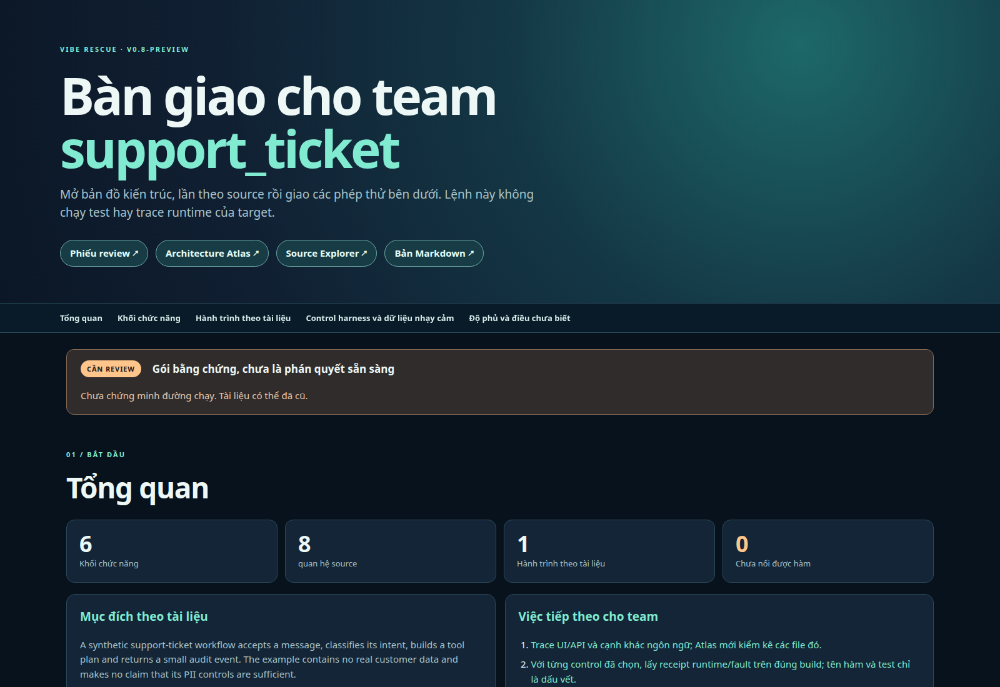
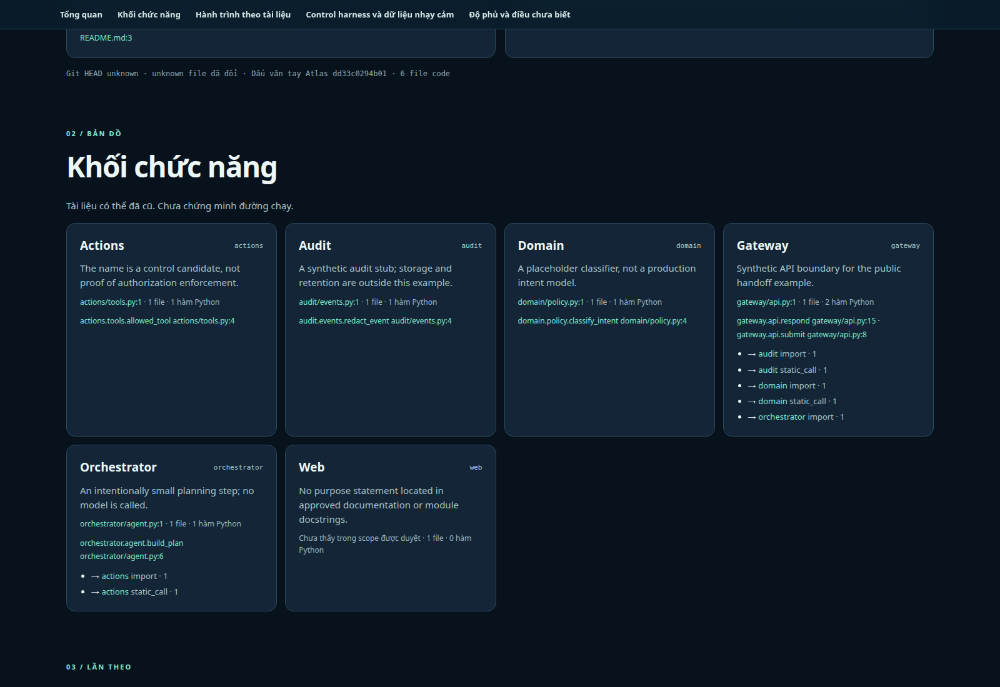

# Vibe Rescue: biến repo lạ thành bản bàn giao cho cả team

[English](README.md) · Tiếng Việt · [Hướng dẫn đầy đủ](docs/GUIDE.vi.md)

Tác giả: [Nguyễn Anh Nguyên](https://github.com/thusinh1969) (Nguyen Anh Nguyen) · miễn phí, mã nguồn mở (MIT)

<!-- markdownlint-disable MD013 -->

**Vibe Rescue** tạo bản bàn giao có link tới source cho team mới tiếp nhận một repo khó hiểu: repo làm gì, các phần nối nhau thế nào, bước xử lý nào ứng với hàm thật và điều gì phải kiểm chứng trước khi hệ thống nhạy cảm được phát hành. Lượt đầu chạy offline, không cần AI. Khi team sẵn sàng, công cụ có thêm scanner và quy trình sửa cần owner duyệt.

## Chạy trong 1 phút

Cần Git, Python 3.11 trở lên và Bash. Không cần cài gì bằng pip: lần chạy `./vr` đầu tiên tự tạo môi trường riêng trong `.venv` (khoảng 10 giây).

```bash
git clone https://github.com/thusinh1969/vibe_rescue.git
cd vibe_rescue
./vr doctor                               # kiểm tra máy bạn, báo thiếu gì và cách sửa
./vr explore ~/path/to/your-project       # bản đồ và bản bàn giao cho team, không cần AI, vài giây
./vr check   ~/path/to/your-project       # vấn đề cụ thể kèm file và dòng, không cần AI
```

Sau đó mở `~/path/to/your-project/VIBE_RESCUE/START_HERE.md`: một trang cho biết đã tìm thấy gì và nên mở file nào tiếp theo. File của dự án bạn không bị thay đổi, và thư mục `VIBE_RESCUE/` tự được Git bỏ qua. Dự án phải là một repo Git; nếu chưa, chạy `git init && git add -A && git commit -m "before rescue"` trong đó trước.

Muốn có báo cáo AI bằng lời thường và các bản sửa do bạn duyệt, đi tiếp ở [Bước 3](#bước-3-báo-cáo-ai-tùy-chọn) và [Bước 4](#bước-4-sửa-khi-bạn-đồng-ý). Phần giải thích dài hơn nằm trong [hướng dẫn đầy đủ](docs/GUIDE.vi.md).

## Bạn nhận được gì

Tất cả được ghi vào thư mục `VIBE_RESCUE/` bên trong dự án của bạn.

| file | là gì | dành cho |
|---|---|---|
| `START_HERE.md` | một trang: tìm thấy gì, mở gì tiếp (tiếng Việt và tiếng Anh) | mọi người |
| `handoff.vi.html`, `handoff.html` | bản bàn giao cho team: mục đích, khối chức năng, hàm cần xem, điều chưa biết | thành viên mới |
| `HANDOFF.md` | cùng nội dung dạng văn bản; dán vào Claude, Codex hoặc model bất kỳ | bạn và AI của bạn |
| `REVIEW_WORKSHEET.md` | ai chứng minh việc gì; chạy lại vẫn giữ phần bạn sửa | trưởng nhóm |
| `architecture.html`, `source-explorer.html` | bản đồ kiến trúc và chỉ mục hàm tìm kiếm được | kỹ sư |
| `atlas/INDEX.md` | bản đồ cho mọi ngôn ngữ tìm thấy (Python, JavaScript/TypeScript, Rust, Go, Java, PHP, C#); `manifest.json` ở đó cho biết đầy đủ đến đâu | kỹ sư |
| `check/findings.md` | danh sách vấn đề kèm file, dòng và luật | kỹ sư |
| `report/README.md`, `PROPOSALS.md` | báo cáo AI bằng lời thường, mỗi vấn đề một thẻ (sau Bước 3) | cả team |
| `report/po-summary.html`, `po-detail.html` | slide ngắn và trang chi tiết cho PO, dựng từ `PO_SUMMARY.md` và `PO_DETAIL.md` khi bước review của AI có viết hai file này | PO |

## v0.8-preview — có gì mới

- **Một lệnh, cả team có bản bàn giao.** Atlas generic nay tạo handoff HTML và Markdown bằng tiếng Anh và tiếng Việt, cùng phiếu review để team điền ở mỗi ngôn ngữ. Chạy lại không ghi đè phiếu.
- **Từ mục đích tới code.** Báo cáo nối mục đích theo tài liệu → khối chức năng → callsite Python → hành trình đánh số → đúng hàm và dòng source. Đường dẫn config/prompt, độ phủ và unknown luôn hiện rõ.
- **Sẵn khung việc review.** Profile agent, swarm, PII/PHI, medical và billing chỉ ra dấu vết source cùng phép thử tiếp theo. Dấu vết không được tự gắn nhãn an toàn hay production-ready; reviewer phải chạy test và trace của target.



[Mở bản bàn giao mẫu đầy đủ](https://thusinh1969.github.io/vibe_rescue/examples/support_ticket/VIBE_RESCUE/handoff.vi.html) · [Đọc gói Markdown](examples/support_ticket/VIBE_RESCUE/HANDOFF.vi.md) · [Chạy trên repo của bạn](#chạy-trong-1-phút).



## Từng bước

### Bước 1: Khám phá (không cần AI)

```bash
./vr explore ~/path/to/your-project
```

Hai việc chạy. **Atlas** vẽ bản đồ mọi ngôn ngữ tìm thấy từ các file được Git theo dõi. **Bản bàn giao** (chỉ Python) nối tài liệu của chính dự án với các khối chức năng và tên hàm. Không việc nào chạy code của bạn. Nếu bản đồ kết thúc với "partial" (mã thoát 2) nghĩa là bản đồ đã có nhưng thiếu một số phần; `atlas/manifest.json` liệt kê phần nào.

### Bước 2: Kiểm tra (không cần AI)

```bash
./vr check ~/path/to/your-project
```

Với dự án Python, lệnh này chạy `ruff`, `vulture`, `radon` và `bandit` (code chết, độ phức tạp, lỗi bảo mật thường gặp). Chọn công cụ khác bằng `--tools`, ví dụ `--tools ruff,deptry,jscpd`; một số cần Node. Lần chạy đầu lưu các vấn đề hôm nay làm **baseline**, nên các lần sau chỉ báo cái mới. Công cụ bị bỏ qua hoặc lỗi thì **chưa kiểm tra gì**; `START_HERE.md` liệt kê chúng ở mục "CHƯA kiểm tra".

### Bước 3: Báo cáo AI (tùy chọn)

AI giải thích các finding bằng lời thường. Bản đồ và kiểm tra không cần AI. Chọn một:

```bash
./vr ai claude                                    # A: Claude Code, Codex làm người kiểm thứ hai (đã cài và đăng nhập cả hai)
./vr ai openai --url https://your-server/v1 --model MODEL-VIET --checker-model MODEL-KIEM    # B: server kiểu OpenAI bất kỳ
read -rsp 'Key: ' VIBE_AGENT_API_KEY; export VIBE_AGENT_API_KEY     # chỉ cho B; server local có thể không cần khóa
./vr report ~/path/to/your-project
```

Cách B dùng được với model mở bạn tự host và với model host sẵn bất kỳ; hãy dùng hai model khác nhau cho người viết và người kiểm. Hiện mới thử một model host sẵn trên một dự án mẫu nhỏ. AI nhận được code của bạn và các finding, nên chỉ dùng ở nơi bạn được phép chia sẻ code đó với nó. Mở `VIBE_RESCUE/report/README.md`, rồi `PROPOSALS.md`. Nếu `./vr report` báo AI không viết báo cáo thì bạn nhận được mẫu điền sẵn; chạy `./vr doctor`.

### Bước 4: Sửa khi bạn đồng ý

```bash
./vr fix ~/path/to/your-project --test "python -m pytest -q"
```

`--test` là lệnh chứng minh dự án chạy được hôm nay. Nó phải đạt **trước** khi có bất kỳ thay đổi nào và **không được để lại file mới** (ví dụ `__pycache__/` của Python); hãy thêm chúng vào `.gitignore` của dự án. Sau đó: AI viết một kế hoạch nhỏ, bạn duyệt; tạo tag sao lưu; bản sửa được làm trên nhánh riêng; test của bạn và các công cụ kiểm tra chạy lại; AI thứ hai xem lại; bạn quyết định có gộp hay không, và `REVERT.md` cho lệnh hoàn tác. Không ai trả lời thì lượt chạy dừng. Không có gì tự gộp.

## Khi có trục trặc

| bạn thấy | làm gì |
|---|---|
| "not a Git repository" | trong dự án: `git init && git add -A && git commit -m "before rescue"` |
| "Python 3.11 or newer is required" | cài Python 3.11+, rồi chạy lại `./vr` |
| `./vr doctor` báo MISSING | làm theo dòng bên dưới |
| bản đồ "partial" (mã thoát 2) | mở `VIBE_RESCUE/atlas/manifest.json`; file liệt kê phần thiếu, ví dụ thiếu Node cho JavaScript |
| công cụ kiểm tra "FAILED" hoặc "skipped" | công cụ chưa chạy; đọc `VIBE_RESCUE/logs/check.log` để biết lý do |
| "no AI is configured yet" | Bước 3 |
| muốn xóa sạch | trong dự án: `rm -rf VIBE_RESCUE .rescue .ruff_cache`; không có gì khác được tạo ra |

## Giới hạn

- Bản đồ là tĩnh: cho biết ai có thể gọi ai, không phải hành vi khi chạy thật. Bản bàn giao chung chỉ nối các hàm Python; ngôn ngữ khác nhận bản đồ cấp file.
- Một finding là bằng chứng để xem xét, không phải chứng minh có lỗi.
- Nhánh Git không phải môi trường cô lập an toàn. Công cụ kiểm tra, test và chương trình AI chạy với quyền của máy bạn; hãy dùng máy cô lập cho code bạn không tin.
- Tự sửa code production không giám sát chưa được duyệt. Việc sửa luôn cần một người.

## Tóm tắt nhanh (FAQ)

**Vibe Rescue là gì?**
Bộ công cụ miễn phí, giấy phép MIT, biến một repo Git lạ hoặc do AI viết ("vibe coding") thành bản bàn giao có liên kết tới mã nguồn: bản đồ file, hàm và lời gọi, danh sách vấn đề cụ thể kèm file và dòng, và chỉ khi chủ repo đồng ý mới có bản sửa nhỏ, hoàn tác được.

**Có miễn phí không, có cần AI không?**
Miễn phí. Lập bản đồ và bản bàn giao chạy offline, không cần AI. Các bước dùng AI (báo cáo, kế hoạch, sửa) là tùy chọn và có thể dùng Claude Code, Codex hoặc bất kỳ server model kiểu OpenAI nào, kể cả model mở bạn tự host. Hiện mới thử một model được host sẵn trên một dự án mẫu nhỏ.

**Code của tôi có rời khỏi máy không?**
Không với việc lập bản đồ và kiểm tra, vì chúng chạy ngay trên máy (công cụ kiểm tra của bên thứ ba có thể được tải về). Các bước AI tùy chọn gửi code và kết quả kiểm tra tới AI bạn chọn.

**Hỗ trợ những ngôn ngữ nào?**
Python, JavaScript/TypeScript, Rust, Go, Java, PHP và C#, với mức chi tiết khác nhau. Bản bàn giao chung chỉ nối được các hàm Python.

**Nó có tự sửa code của tôi không?**
Nó chuẩn bị bản sửa nhỏ trên một nhánh riêng. Mỗi kế hoạch, lần sửa và lần gộp đều cần một người nói đồng ý, và có file hướng dẫn hoàn tác. Tự sửa code production không giám sát chưa được duyệt.

**Khác gì các dịch vụ "cứu code vibe coding" trả phí?**
Đó là dịch vụ con người làm thay. Vibe Rescue là công cụ miễn phí bạn tự chạy, với bằng chứng bạn kiểm tra được. Nó không thay thế phán đoán của kỹ sư.

## Người đóng góp

Theo thứ tự:

1. **Nguyễn Anh Nguyên**: tác giả và người duy trì.
2. **DeepSeek**: cộng tác viên AI; chạy đánh giá model và rà soát hình ảnh của tài liệu (xem [STATUS.md](STATUS.md)).
3. **Codex** (OpenAI): cộng tác viên AI; các phiên bản trước và việc kiểm tra độc lập.
4. **Claude** (Anthropic): cộng tác viên AI; viết lại README, adapter kiểu OpenAI và chuẩn bị phát hành.

## Trạng thái và giấy phép

**v0.8-preview** tạo bản bàn giao có link tới source từ mọi scope repo được duyệt, kèm phiếu giao người và ghi receipt đúng build. [Hợp đồng bản preview](docs/V0.8_PREVIEW.vi.md) ghi rõ Atlas generic chứng minh được gì và phần nào vẫn cần reviewer. Bản control review sâu do người review viết; tool chưa tự tạo phán quyết an toàn tương đương cho mọi team. Sửa code vẫn cần owner duyệt và còn [khoảng trống an toàn](STATUS.md#current-preview-gaps). Công cụ đóng gói có thể chuẩn hóa `0.8.0-preview` thành `0.8.0rc0`.

Giấy phép: [MIT](LICENSE).

<!-- markdownlint-enable MD013 -->
