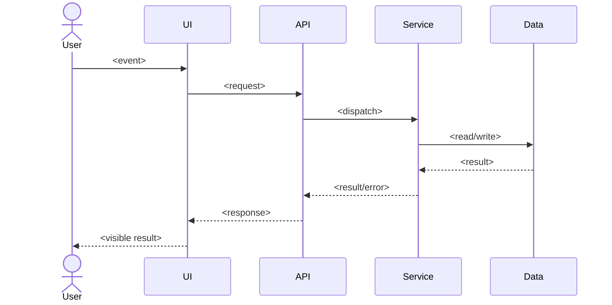

# Journey: <hành vi người dùng, không đặt theo tên file>

> Trạng thái: DRAFT | SOURCE_VERIFIED | RUNTIME_VERIFIED. Commit: `<full SHA>`.
> Owner: `<team/person>`. Scope: `<feature>`.

## Câu hỏi mà người mới phải trả lời được

- Người dùng làm gì, đầu vào là gì, đầu ra nhìn thấy là gì?
- Ai quyết định từng nhánh? Ranh giới frontend/API/service/worker/data ở đâu?
- Dữ liệu hoặc yêu cầu có thể bị từ chối, timeout, hủy, retry ở đâu?
- Những điều gì chưa biết hoặc chưa được probe?

## Sequence theo hành vi

## Bảng cạnh có chứng cứ

| Từ → đến | Loại cạnh | Điều kiện/flag | Source `file:line` | Bằng chứng | Tin cậy |
|---|---|---|---|---|---|
| UI handler → API client | call | ... | ... | source | SOURCE_VERIFIED |
| API route → service | call/queue/event | ... | ... | trace/test id | RUNTIME_VERIFIED |

`inferred` chỉ là giả thuyết. Đừng chuyển thành `verified` vì sơ đồ đẹp hoặc LLM nói vậy.

## Nhánh đối chứng (Harness²)

| Ca | Input tổng hợp | Nhánh mong đợi | Bằng chứng chạy | Kết quả |
|---|---|---|---|---|
| happy | ... | ... | test/trace id | ... |
| error/timeout | ... | ... | test/trace id | ... |
| config khác | ... | ... | test/trace id | ... |

## Unknowns và cập nhật

- [ ] Chưa xác định: ...; cách kiểm: ...; người phụ trách: ...
- PR đổi cạnh nào phải cập nhật cạnh đó và chạy lại ca đối chứng tương ứng.
